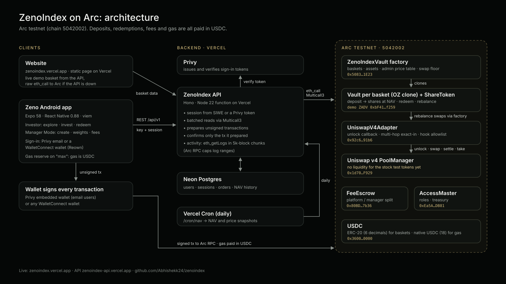

# ZenoIndex on Arc

On-chain index baskets (DTFs) on **Arc testnet**. Investors put USDC into a basket and get shares;
managers create baskets, set target weights and rebalance through Uniswap v4; deposit and redemption
fees are accounted on-chain in a FeeEscrow. Investors use the Zeno mobile app (Android APK), signing
with any WalletConnect wallet or a Privy email wallet.

**Live:** website [zenoindex.vercel.app](https://zenoindex.vercel.app) · API [zenoindex-api.vercel.app](https://zenoindex-api.vercel.app/docs) ·
Android app [latest release](https://github.com/Abhishekk24/zenoindex/releases/latest)

| Package | What |
|---|---|
| [`contracts/`](contracts) | Solidity (Foundry): basket factory, vault clones, access control, fee escrow, Uniswap v4 adapter. Arc build: `src/arc`, `FOUNDRY_PROFILE=arc` |
| [`backend/`](backend) | TypeScript API (Hono + Postgres) and `@zenoindex/sdk`: reads baskets from chain, prepares unsigned transactions, verifies mined ones |
| [`mobile/`](mobile) | Expo / React Native investor + manager app |
| [`website/`](website) | Static landing page (Vercel): live demo basket, APK download, how to try it |

Deployments: `backend/` and `website/` are two Vercel projects that deploy from `main` (each only when its
folder changes). The API runs as one Node function with Neon Postgres and a daily cron for NAV snapshots.

## Arc testnet deployment

Chain ID `5042002` · RPC `https://rpc.testnet.arc.io` · Explorer [testnet.arcscan.app](https://testnet.arcscan.app)

| Contract | Address |
|---|---|
| ZenoIndexVault factory | [`0x50838499F82f13A527819b748d467CB7ba671E23`](https://testnet.arcscan.app/address/0x50838499F82f13A527819b748d467CB7ba671E23) |
| AccessMaster | [`0xEa5A7B27E511e831e1BfBb10F4B63Ea11077DB81`](https://testnet.arcscan.app/address/0xEa5A7B27E511e831e1BfBb10F4B63Ea11077DB81) |
| FeeEscrow | [`0x80BD86f5778C3cD3Dd55502cab55F4Ea96e87b36`](https://testnet.arcscan.app/address/0x80BD86f5778C3cD3Dd55502cab55F4Ea96e87b36) |
| Uniswap v4 adapter | [`0x92c64e17a1A4c5B28a26B30102Ac1D453A7991b6`](https://testnet.arcscan.app/address/0x92c64e17a1A4c5B28a26B30102Ac1D453A7991b6) |
| Vault implementation | [`0x0c840Ec559a06De4cA1fcCbc795C21844c421bDb`](https://testnet.arcscan.app/address/0x0c840Ec559a06De4cA1fcCbc795C21844c421bDb) |
| Demo basket (ZADV) | [`0xbF41248213C650bb7D14A6caC985e77b1Bacf259`](https://testnet.arcscan.app/address/0xbF41248213C650bb7D14A6caC985e77b1Bacf259) |

Baskets are priced in Arc's ERC-20 USDC (`0x3600…0000`, 6 decimals). Arc pays gas in the same
USDC (18 decimals natively), so the app keeps a fee reserve out of "max" deposits.

## Uniswap v4 integration

Vaults rebalance through Uniswap v4: a vault calls the factory's
[`executeSwap`](contracts/src/arc/ZenoIndexVault.sol#L381-L394), which applies a price-table floor to
`minAmountOut` and calls our router,
[`UniswapV4Adapter`](contracts/src/arc/adapters/UniswapV4Adapter.sol#L121-L203). The adapter opens one
`PoolManager.unlock` per swap and runs every hop of a multi-hop exact-input path inside `unlockCallback`
(`swap`, `sync`/`settle` the input, `take` the output). It only accepts allowlisted hooks and rejects hook
deltas that would make it settle more than it received. Our developer feedback, with links to each line,
is in [FEEDBACK.md](FEEDBACK.md).

On Arc testnet the adapter is deployed against PoolManager `0x1d70…F929`. The canonical v4 deployment there
is `0x8366…0951`, which is where the official Quoter, StateView and PositionManager point. Moving the adapter
to the canonical manager and seeding pools for the basket tokens is the next step (see FEEDBACK.md).

## What existed before the hackathon, and what we built at ETHGlobal

This repository keeps the **full original git history** of the three projects it merges (imported
with `git subtree`, original authors, dates and commit hashes intact), so the timeline is verifiable.

**Before the hackathon (21 Sep – 27 Oct 2026):** ZenoIndex was built for Robinhood Chain: the core
vault, factory, access control, fee escrow and Uniswap v4 adapter contracts; the API and SDK; and the
mobile app. That is every commit up to and including `150fa81` / `ef58904` / `d3d51b5`.

**At the hackathon (from 5 Nov 2026), porting ZenoIndex to Arc:**

| Area | Work | Commits |
|---|---|---|
| Contracts | Arc build (`src/arc`): zero-address and path-length checks, overflow-safe price math (`FullMath`), regression tests; deployed factory, escrow, access control, adapter and a demo basket on Arc testnet | `03a0133` |
| API | Arc chain selection; Multicall3 and 18-decimal native USDC for Arc (every read failed without it); USDC as the base asset | `4a7413b`, `6879c60` |
| Mobile | Arc network support; onboarding redirect loop under Expo Router 58; gas reserve on "max" because Arc gas is USDC; network-fee estimate; trade panel and Manager Mode fixes | `e6b894c`, `e02ecd6`, `323e575` |
| Delivery | This monorepo, Vercel deployment of the API and website, the Android APK | commits after `e0e3038` |

End-to-end on Arc testnet (deposit → shares → redeem → claim, fees to FeeEscrow) was verified through
the API and in the app, e.g. deposit
[`0x77f74c18…`](https://testnet.arcscan.app/tx/0x77f74c18581f21918caf0d3552a4933cfc6577448ed90cc7b546647cdea2c4b9)
and claim
[`0xf4ec3a65…`](https://testnet.arcscan.app/tx/0xf4ec3a65d5e799960975e5096a2c746a822e845b9c96f4044bb9d999efbf5630).

## Current limits on Arc testnet

- The stock tokens (NVDA, TSLA, META, MU, SPCX) are test tokens with no Uniswap v4 liquidity yet, so
  baskets hold their deposits in USDC and redeem in USDC; swaps into the constituents are not live.
- Asset prices are set by the super-admin and expire after 24 h (`maxPriceAge`).
- Creating a basket needs the super-admin to allowlist the manager wallet (`setVaultCreator`).
- Arc's public RPC limits `eth_getLogs` to under 10k blocks, so basket activity is read in 5k-block chunks
  back from the chain head (about the last two days of activity per refresh).

## Run it

- Contracts: `cd contracts && FOUNDRY_PROFILE=arc forge test`
- API: see [`backend/README.md`](backend/README.md); `ZENO_CHAIN=arc-testnet` selects Arc.
- App: see [`mobile/README.md`](mobile/README.md); `EXPO_PUBLIC_CHAIN=arc-testnet` selects Arc.

## Credits and license

Built by the ZenoIndex team: see `git shortlog -sn` for every contributor. `contracts/` is GPL-3.0
(see [`contracts/LICENSE`](contracts/LICENSE)); `contracts/lib/` vendors forge-std, Uniswap v4-core and
OpenZeppelin under their own licenses.
